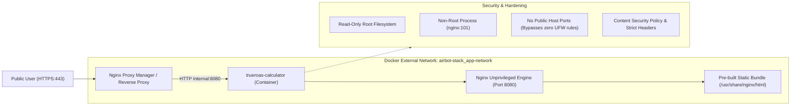

# Production Deployment Guide: TrueROAS Calculator

This guide details how to deploy **TrueROAS & Unit Economics Calculator** using **Portainer** behind a Reverse Proxy (e.g. Nginx Proxy Manager / Traefik) on the shared server network (`airbot-stack_app-network`), leveraging our private image pipeline on GitHub Container Registry (`ghcr.io`).

---

## 1. Architecture Overview



### Key Architectural Strengths:
1. **Zero Host Port Exposure**: The container does not publish ports to `0.0.0.0` on the host, preventing bypass of Linux UFW firewall rules via Docker `iptables`.
2. **Internal Proxy Networking**: Communicates exclusively via the internal Docker bridge network (`airbot-stack_app-network`) directly with your reverse proxy.
3. **Hardened Unprivileged Container**: Built on `nginxinc/nginx-unprivileged:1.27-alpine` with `read_only: true` and non-root execution (UID 101).
4. **Lightweight & Fast**: Total image size is ~21 MB, booting in milliseconds with <10 MB RAM consumption.

---

## 2. Step-by-Step Server Deployment (Portainer)

### Step 1: Add GHCR Registry Credentials in Portainer (One-Time Setup)
Since your container image is **private**:
1. On GitHub: Go to **Settings** $\rightarrow$ **Developer settings** $\rightarrow$ **Personal access tokens** $\rightarrow$ **Tokens (classic)**.
2. Generate a token with the **`read:packages`** scope.
3. In Portainer: Navigate to **Settings** $\rightarrow$ **Registries** $\rightarrow$ **Add registry**.
4. Choose **Custom registry**:
   * **Name**: `GitHub Container Registry`
   * **Registry URL**: `ghcr.io`
   * **Authentication**: `ON`
   * **Username**: `Mostafa-Elmoalem`
   * **Password**: Paste your GitHub Personal Access Token.
5. Click **Add registry**.

---

### Step 2: Deploy the Stack in Portainer
1. In Portainer: Go to **Stacks** $\rightarrow$ **Add stack**.
2. **Name**: `trueroas-calculator`
3. Under **Build method**, select **Web editor** and paste the contents of [`docker-compose.prod.yml`](file:///d:/Other/.MY%20Work/Software%20Development/DEV%20work%20-%20new%20ideas/ROAS-Ecommerce%20breakeEvenn/docker-compose.prod.yml):

```yaml
services:
  app:
    image: ghcr.io/mostafa-elmoalem/roas-unit-economics-calculator:latest
    pull_policy: always
    container_name: trueroas-calculator
    restart: unless-stopped
    expose:
      - "8080"
    read_only: true
    tmpfs:
      - /tmp
    security_opt:
      - no-new-privileges:true
    healthcheck:
      test: ["CMD-SHELL", "wget -qO- http://127.0.0.1:8080/health || exit 1"]
      interval: 30s
      timeout: 3s
      start_period: 5s
      retries: 3
    deploy:
      resources:
        limits:
          cpus: "1.0"
          memory: 256M
        reservations:
          cpus: "0.1"
          memory: 64M
    logging:
      driver: "json-file"
      options:
        max-size: "10m"
        max-file: "3"
    networks:
      - default
      - proxy-network

networks:
  default:
  proxy-network:
    external: true
    name: airbot-stack_app-network
```

4. Click **Deploy the stack**.

---

### Step 3: Configure Reverse Proxy (e.g. Nginx Proxy Manager)
1. In Nginx Proxy Manager (or your server's proxy): Go to **Proxy Hosts** $\rightarrow$ **Add Proxy Host**.
2. **Details Tab**:
   * **Domain Names**: `roas.yourdomain.com` (or your chosen subdomain)
   * **Scheme**: `http`
   * **Forward Hostname / IP**: `trueroas-calculator` *(resolved via Docker DNS on `airbot-stack_app-network`)*
   * **Forward Port**: `8080`
   * Check **Cache Assets**
   * Check **Block Common Exploits**
   * Check **Websockets Support**
3. **SSL Tab**:
   * Request a new **Let's Encrypt** SSL Certificate
   * Check **Force SSL**
   * Check **HTTP/2 Support**
   * Check **HSTS Enabled**
4. Click **Save**.

Your app is now live and secured over HTTPS!

---

### Step 4: Fully Automated Redeployment via Webhook (CI/CD)
1. In Portainer, open your deployed stack (`trueroas-calculator`).
2. Toggle **Webhook** to **ON** and copy the generated Webhook URL.
3. On GitHub: In this repository, go to **Settings** $\rightarrow$ **Secrets and variables** $\rightarrow$ **Actions**.
4. Add secret:
   * **Name**: `PORTAINER_WEBHOOK_URL`
   * **Value**: Your copied Portainer Webhook URL.

Whenever you `git push` to `main`, GitHub Actions automatically:
1. Validates code (`oxlint` and `tsc`).
2. Builds and tags the multi-arch container image.
3. Pushes the private image to `ghcr.io`.
4. Triggers the Portainer Webhook to immediately pull the new image and reload the container with zero downtime!

---

## 3. Useful Operational Commands

```bash
# Check container health and status
docker ps --filter "name=trueroas-calculator"

# View real-time web server logs
docker logs -f trueroas-calculator

# Manually test the internal health check
docker exec trueroas-calculator wget -qO- http://127.0.0.1:8080/health
```
